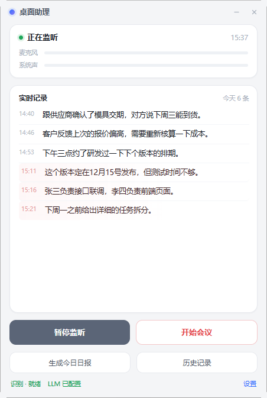
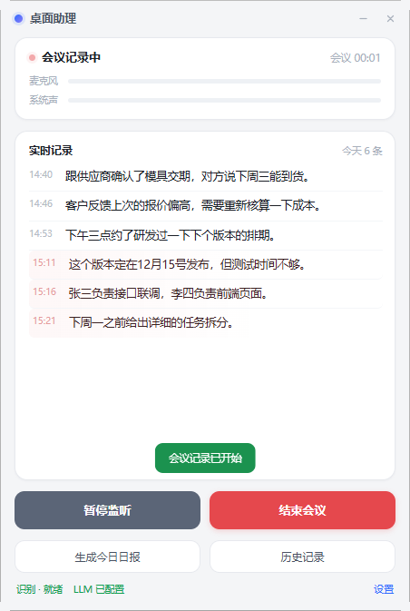

<div align="center">

# 桌面助理 · Desktop Assistant

**一个常驻桌面的语音记录助手：边听边记，下班自动出日报，开会点一下按钮就出纪要。**

All speech recognition runs **locally & offline** — your audio never leaves your computer.
（音频不出本机；但**转写出来的文字**在生成日报/纪要时会发送给你自己配置的大模型，见[隐私说明](#隐私说明)。）

[](https://www.python.org/)
[](#环境要求)
[](#它是怎么工作的)
[](LICENSE)




</div>

---

## 它解决什么问题

开会时你在听，就没法记；在记，就没法听。会后凭记忆补纪要，细节永远是糊的。

这个工具的思路是把它变成后台进程：平时一直听着，重要的地方它替你记下来；一天结束自动归类成日报；开会时点一下按钮做个标记，会议结束后自动出结构化纪要（摘要 / 讨论要点 / 结论 / 行动项 / 风险）。

**特点**

- 🎙 **双路混录**：麦克风 + 系统声音回环同时采集。线上会议对方的声音从扬声器出来，只录麦克风等于只录了你自己。
- 🔒 **完全离线识别**：SenseVoice（INT8）跑在 CPU 上，音频不出本机，不需要联网，也不产生费用。
- ⚡ **比实时快 20 倍**：实测 3 秒音频转写耗时 0.15 秒，全天挂着也不会积压。
- ✍️ **自带标点、中英混说**：不用再读没有标点的转写文本。
- 📄 **总结接你自己的模型**：任何 OpenAI 兼容接口（DeepSeek / 通义 / Kimi / 智谱 / 本地 Ollama），不绑定服务商。
- 🧾 **纯文本落盘**：记录存成 `.jsonl`，报告存成 `.md`，随时能改、能 grep、能进 Git。

---

## 界面上的四个按钮

| 按钮 | 作用 |
|---|---|
| **开始监听** | 持续采集麦克风 + 系统声音，自动切句、转写、实时显示。可以一整天开着 |
| **开始会议 / 结束会议** | 进入会议模式（状态点变红并计时），结束时自动整理纪要并打开「会议记录」页 |
| **生成今日日报** | 立刻把今天所有记录整理成结构化日报 |
| **历史记录** | 浏览已生成的日报；点会议条目进入会议记录页（纪要 / 原文两个标签） |

### 会议记录页

点历史里的任意一条会议，会进入独立的会议页：

- **纪要**：AI 整理的摘要、讨论要点、关键结论、行动项表格、风险
- **原文**：这场会议的逐句转写（带时间戳），随时对照，不会被摘要替代
- **重新整理**：换模型、或上次 AI 被服务端风控拦下时，点一下重新生成，覆盖同一份文件

> 大模型网关的内容风控是**概率性**的（同一段文本重复请求，实测约 1/3 会被拒）。遇到拒绝会自动重试；仍失败时**不会**把英文报错写进纪要，而是改用内置的本地规则整理（分时间段 + 抽出结论/行动项/风险），并在页面上说明原因，之后可以再点「重新整理」。

<table>
<tr>
<td></td>
<td></td>
</tr>
</table>

---

## 环境要求

- **Windows 10 / 11**（依赖 WASAPI 回环录音，暂不支持 macOS / Linux）
- **Python 3.10+**（勾选 *Add python.exe to PATH*）
- WebView2 运行时（Win11 自带；Win10 若缺失，[下载安装](https://developer.microsoft.com/microsoft-edge/webview2/)）

---

## 快速开始

```bash
git clone https://github.com/Dylan18/meeting-mate.git
cd meeting-mate
```

**双击 `启动.bat`**。首次运行会自动创建虚拟环境、安装依赖；识别模型（约 1GB，只保留 INT8 版本共 229MB）在第一次点「开始监听」时自动下载，界面上会显示进度。

也可以用命令行：

```bash
python -m venv .venv
.venv\Scripts\pip install -r requirements.txt
.venv\Scripts\python main.py
```

> 依赖安装慢就加国内镜像：`-i https://pypi.tuna.tsinghua.edu.cn/simple`

想让电脑开机就自动跑：`Win+R` → 输入 `shell:startup` → 把 `启动.bat` 的**快捷方式**拖进去。

---

## 第一次使用要做的两件事

### 1. 配大模型（不配也能用，只是没有总结）

设置 → 大模型 → 点一个预设 → 填 API Key → 测试连接 → 保存。

| 服务 | 接口地址 | 模型名 |
|---|---|---|
| DeepSeek | `https://api.deepseek.com/v1` | `deepseek-chat` |
| 通义千问 | `https://dashscope.aliyuncs.com/compatible-mode/v1` | `qwen-plus` |
| Kimi | `https://api.moonshot.cn/v1` | `moonshot-v1-8k` |
| 智谱 | `https://open.bigmodel.cn/api/paas/v4` | `glm-4-flash` |
| 本地 Ollama | `http://127.0.0.1:11434/v1` | `qwen2.5:7b` |

没配 Key 时不会报错：纪要/日报改用本地规则整理（分段时间轴 + 结论/行动项/风险），结构一样，只是语言不如大模型精炼。配好 Key 后点会议页的「重新整理」即可换成 AI 版本。

### 2. 确认音源

- **线上会议**（腾讯会议 / 飞书 / Zoom）：麦克风和系统声音**都要开**。
- **线下面对面**：只开麦克风即可。

---

## 它是怎么工作的

```
麦克风 ─┐
        ├─ 100ms 对齐混音 → 16kHz 单声道 → 能量 VAD 切句 → SenseVoice 转写 ─┐
系统回环 ┘                                                              │
                                                                        ▼
                                              按天落盘 data/sessions/*.jsonl
                                                                        │
                                     ┌──────────────────────────────────┤
                                     ▼                                  ▼
                          日报（18:30 自动 / 手动）           会议纪要（按钮触发）
                                     └──────────► LLM 总结 ◄───────────┘
                                                     │
                                          data/reports/*.md
```

- **采集**：`soundcard` + WASAPI，麦克风与扬声器回环两路并行，按 100ms 块对齐混音
- **校准**：点「开始监听」后先听 2 秒环境音定噪声底。这 2 秒不进转写，但能避免空调/风扇把阈值顶死（详见[为什么先静音 2 秒](#为什么开始监听后要静音-2-秒)）
- **切句**：能量 VAD + 启动校准 + 稳态噪声兜底，静音 0.7s 断句，保留 0.4s 预录防止吞字，单段上限 20s
- **识别**：`sherpa-onnx` + SenseVoice（INT8 / CPU），中英混说、自带标点；可选轻量 Paraformer
- **总结**：任意 OpenAI 兼容接口，长文本自动分段 map-reduce（3 路并发），避免超上下文
- **界面**：WebView2 + 原生 HTML/CSS/JS，无前端构建、无外部 CDN

---

## 数据存在哪

```
data/
├── sessions/2026-11-19.jsonl     ← 当天所有语音片段（带时间戳、来源标记）
├── reports/日报_2026-11-19.md
├── reports/会议_20261119_1430_周会.md
├── meetings/*.json               ← 每场会议的结构化数据（逐句原文 + 引擎/提示）
├── logs/                         ← 崩溃日志
└── settings.json                 ← 配置（含 API Key，已被 .gitignore 排除）
```

全部是纯文本，可以直接用编辑器打开、复制、备份。

---

## 自动日报

设置里可指定每天几点生成（默认 **18:30**）。到点后若当天已有记录，自动生成并弹出来。

第二天启动时，如果昨天漏了，会自动补一份。

---

## 目录结构

```
meeting-mate/
├── 启动.bat                一键启动（首次自动装环境）
├── main.py                 入口：创建窗口、加载位置记忆
├── requirements.txt        直接依赖
├── requirements.lock       实测可用的完整版本快照
├── pyproject.toml          pytest / ruff 配置
├── app/
│   ├── audio.py            采集 / 混音 / VAD 切句
│   ├── asr.py              识别引擎（sherpa-onnx）+ 退出排空队列
│   ├── model_fetch.py      模型下载与精简（多镜像 + 断点续传）
│   ├── llm.py              大模型调用与 prompt（风控拒绝识别 + 重试）
│   ├── minutes.py          无大模型时的本地纪要整理（抽出式）
│   ├── store.py            按天存储、报告与会议结构化数据
│   ├── assistant.py        业务编排（任务串行、日报、纪要）
│   ├── config.py           配置读写与校验
│   ├── log.py              统一异常日志（error.log 轮转）
│   └── ui/
│       ├── bridge.py       Python ↔ JS 桥接
│       └── web/            界面（index.html / style.css / app.js）
├── tests/                  pytest 用例（VAD / 配置 / LLM / 存储 / 编排）
├── docs/screenshots/       README 配图
└── data/ models/           运行时生成，不入库
```

---

## 开发

```bash
.venv\Scripts\pip install pytest ruff
.venv\Scripts\python -m pytest tests -q      # 45 项，约 1 秒
.venv\Scripts\python -m ruff check app main.py tests
```

CI（GitHub Actions）在每次 push 时跑 lint + 测试 + 导入冒烟，配置见 `.github/workflows/ci.yml`。

---

## 常见问题

**录不到会议里对方的声音**
系统声音没开，或设备被会议软件独占。检查设置里「系统声音」是否勾选；用耳机时回环会自动跟随默认扬声器。

**识别不准**
- 说话离麦克风近一点，环境噪音大会影响切句
- 专业术语（型号、缩写）识别错误属正常现象，可在生成的纪要里手改
- 纯中文场景可换 `Paraformer 轻量版`（78MB，更快，但无标点）

**一直显示「加载中」**
首次使用要下载模型（约 1GB），进度显示在状态栏。**这几分钟的语音不会被丢掉**——会暂存最近 120 秒，模型就绪后自动补转。下载失败会自动切换镜像重试。

**状态点变红、提示「录音异常」**
说明麦克风或系统回环读不到数据（设备被拔出、被会议软件独占）。恢复后提示会自动消失，不需要重启程序；如果一直不恢复，换个设备再点一次「暂停监听 → 开始监听」。

**为什么开始监听后要静音 2 秒**
程序用这 2 秒测环境底噪。以前底噪只在"判定为静音"时更新，而"是不是静音"又依赖底噪——办公室空调一到 0.01 就把自己锁死在"一直有人说话"，每 20 秒吐一段噪声去转写。现在改成启动先校准，之后短暂安静会快速跟随、说话时几乎不动，另有"能量太平稳就判为稳态噪声"的兜底。

**双击没反应 / 闪退**
看 `data/logs/crash.log`；`data/logs/error.log` 里是被降级处理的异常（落盘失败、采集中断等）；命令行跑 `python main.py` 能看到实时报错。

**能不能录到别人的电脑？**
不能，也不打算支持。它只采集本机的麦克风和本机正在播放的声音。

---

## 隐私说明

- **音频**：全程本地处理，不上传、不落盘（只保留切句后的瞬时缓冲，转写完即释放）。
- **文字**：转写文本会保存到 `data/sessions/*.jsonl`；生成日报 / 纪要时，**这段文本会发送给你在设置里配置的大模型服务商**。介意的话可以填本地 Ollama（`http://127.0.0.1:11434/v1`），数据不出机器。
- **API Key**：明文存放在 `data/settings.json`（已 gitignore）。界面上默认掩码显示，可点「显示」查看。
- **保留期**：本工具不自动清理任何记录，删 `data/` 即清空。

---

## 已知边界

- 仅 Windows（WASAPI 回环是 Windows 独有）
- 说话人分离（谁在说）没有做，会议纪要里统一按内容归类
- 长时间连续说话（>20s 不停顿）会被强制切开，可能切断句子
- **外放 + 麦克风同开时会重复转写**：对方的声音既从扬声器进回环、又从麦克风进来，同一句可能被写两遍。线上会议建议戴耳机；纯外放场景可以只开「系统声音」。
- 专注模式 / 极安静的白噪声（如雨声）理论上仍可能被当成语音：判据是能量起伏，不是音色。遇到时把音量调低或换个音源。

---

## 更新日志

### v1.2.0
- **会议记录页**：历史里点会议进入独立页面，「纪要 / 原文」两个标签，原文是逐句带时间戳的转写，可随时对照
- **纪要不再被接口报错污染**：网关风控返回的 `The request was rejected because it was considered high risk` 以前被当成模型输出写进文件，现在识别为「可重试的拒绝」→ 自动重试 2 次
- **本地纪要兜底**（`app/minutes.py`）：无 Key、AI 失败或被拦时，用纯规则从原文抽出分段时间轴、关键结论、行动项表格、风险；不再输出「未配置大模型」。日报同样有本地兜底
- **重新整理**：会议页一键重跑，覆盖同一份文件（以前按新标题另存，旧坏文件会留着）
- 会议原文落到 `data/meetings/*.json`；老版本生成的会议也能靠时间区间回查原文
- 早期坏掉的纪要会被标注「内容无效」并提示重新整理

### v1.1.0
按代码审核报告修的一轮，重点是"看起来在工作、实际在产出垃圾"的几处：

- **VAD 自锁**（P0）：恒定底噪下永久判为语音 → 启动校准 2s + 噪声底双向跟踪 + 稳态噪声兜底
- **busy 竞态**（P0）：双击按钮可能并发跑两个 LLM 任务 → `Lock.acquire(blocking=False)` 原子占位，任务统一串行
- **退出丢音频**（P0）：队列里未转写的片段被丢弃 → 哨兵 + join 排空，最多等 10s
- **模型未就绪丢音频**（P0）：下载那几分钟的语音被静默丢弃 → 有界暂存（120s）+ 就绪后补转
- **定时日报**（P0）：填 `9:00` 永远不生成 → `strptime` 校验 + 规范化；失败后 30 分钟退避，不再每分钟烧额度
- **mixer 未 join**（P0）：`flush_pending` 与采集线程抢缓冲 → 先停 mixer 再 flush
- **采集中断无感知**（P0）：麦克风被拔了界面还是绿点 → 连续失败/线程死亡上报，状态点变红并显示原因
- 会议标题跨天污染、会议内容不进日报、改语言/设备不生效、测试连接污染配置、tar 路径穿越、LLM 截断静默、`_reduce` 串行、日志不轮转、窗口越界不可见等一并处理
- 新增 45 项测试 + ruff + CI + 依赖锁文件

### v1.0.0
首个可用版本。

---

## License

[MIT](LICENSE)
